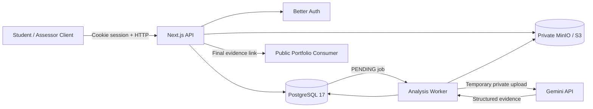

# BuktiPraktik Backend

BuktiPraktik adalah backend monolitik Next.js untuk mengumpulkan video praktik siswa,
mengidentifikasi bukti keterampilan dengan Gemini, memfasilitasi verifikasi asesor, dan
menerbitkan portofolio keterampilan yang dapat dibagikan.

AI hanya membantu menemukan bukti visual berdasarkan rubrik. Skor dan keputusan akhir selalu
ditentukan manusia melalui proses review asesor.

> Kontrak engineering lengkap, keputusan arsitektur, dan aturan untuk coding agent tersedia di
> [AGENTS.md](./AGENTS.md). README ini adalah panduan penggunaan praktis. Jika perilaku kode tidak
> sesuai dengan kontrak target, lihat [Known limitations](#known-limitations).

## Daftar Isi

- [Fitur utama](#fitur-utama)
- [Arsitektur](#arsitektur)
- [Quick start dengan Docker](#quick-start-dengan-docker)
- [Konfigurasi environment](#konfigurasi-environment)
- [API conventions](#api-conventions)
- [API reference](#api-reference)
- [Contoh alur API end-to-end](#contoh-alur-api-end-to-end)
- [Development](#development)
- [Deployment home server](#deployment-home-server)
- [Security dan privasi](#security-dan-privasi)
- [Troubleshooting](#troubleshooting)
- [Known limitations](#known-limitations)

## Fitur Utama

### Siswa

- Registrasi, login, dan pengelolaan profil sekolah/program keahlian.
- Melihat rubrik kompetensi yang aktif.
- Mengunggah video praktik dan melihat status proses penilaian.
- Melihat skor serta feedback setelah review asesor selesai.
- Melihat riwayat penilaian dan portofolio keterampilan.
- Membuat dan mencabut tautan bukti publik yang memiliki masa berlaku.

### Asesor

- Dashboard submission dalam organisasi yang sama.
- Membuat, membuat versi baru, menerbitkan, dan mengarsipkan rubrik.
- Memutar video privat dengan dukungan HTTP Range.
- Melihat evidence dan timestamp hasil analisis AI.
- Mengonfirmasi, menolak, atau menyesuaikan evidence per kriteria.
- Menyimpan draft review, memberi skor/feedback, dan memfinalisasi penilaian.

### Platform

- PostgreSQL-backed job queue dengan bounded retry.
- Gemini multimodal video analysis dengan structured JSON output.
- Private S3-compatible storage menggunakan MinIO.
- Versioned rubrics dan audit event untuk lifecycle submission.
- Docker image yang sama untuk process `web`, `worker`, `migrate`, dan `seed`.

## Arsitektur



Alur utamanya:

1. Siswa mengunggah video dan API segera mengembalikan submission `QUEUED`.
2. Worker mengklaim job menggunakan PostgreSQL `FOR UPDATE SKIP LOCKED`.
3. Worker mengirim video privat dan snapshot rubrik ke Gemini.
4. Evidence tervalidasi disimpan per kriteria; submission menjadi `AWAITING_REVIEW`.
5. Asesor memverifikasi evidence, memberi skor, dan memfinalisasi penilaian.
6. Submission `COMPLETED` muncul di portofolio dan dapat dibuatkan tautan publik.

### Komponen

| Komponen | Tanggung jawab |
|---|---|
| Next.js App Router | HTTP API, auth adapter, authorization, dan response envelope |
| Better Auth | Email/password authentication dan cookie session |
| PostgreSQL 17 + Drizzle | System of record, queue, rubric, evidence, review, dan audit event |
| MinIO/S3 | Penyimpanan video privat |
| Worker | Claim job, pemanggilan Gemini, validasi output, retry, dan persistence |
| Gemini | Ekstraksi evidence video; tidak menentukan nilai akhir |

## Quick Start dengan Docker

### Prerequisite

- Docker Engine dan Docker Compose v2.
- Port `3000`, `5432`, `9000`, dan `9001` tersedia di mesin lokal.
- Gemini API key jika ingin menggunakan analisis nyata.

### Menjalankan stack

1. Buat konfigurasi lokal:

   ```bash
   cp .env.example .env
   ```

2. Ganti `BETTER_AUTH_SECRET` dengan random secret minimal 32 karakter. Isi
   `GEMINI_API_KEY` dan set `FAKE_AI=false` untuk Gemini nyata, atau kosongkan key dan gunakan
   `FAKE_AI=true` untuk pengujian tanpa provider eksternal.

3. Jalankan seluruh service:

   ```bash
   docker compose up -d --build
   ```

4. Periksa service:

   ```bash
   docker compose ps
   curl -fsS http://localhost:3000/api/health/ready
   ```

API tersedia di `http://localhost:3000`. MinIO Console tersedia di
`http://localhost:9001` dan hanya bind ke loopback pada Compose lokal.

Compose menjalankan migration dan seed sebelum menyalakan web/worker. Akun asesor seed mengikuti
`SEED_ASSESSOR_EMAIL` dan `SEED_ASSESSOR_PASSWORD`. Jangan menggunakan credential contoh pada
deployment publik.

### Menghentikan stack

```bash
docker compose down
```

Perintah tersebut mempertahankan volume PostgreSQL dan MinIO. `docker compose down -v` menghapus
seluruh data lokal dan hanya boleh digunakan jika data memang tidak diperlukan.

> Image MinIO memakai `soldevelo/minio:2026.7` karena image Community Edition upstream tidak lagi
> tersedia dari registry publik yang sebelumnya digunakan.

## Konfigurasi Environment

Gunakan `.env.example` sebagai template. Jangan commit `.env` atau menampilkan nilainya dalam log.

### Application dan authentication

| Variable | Wajib | Keterangan |
|---|---:|---|
| `NODE_ENV` | Ya | `development`, `test`, atau `production` |
| `BETTER_AUTH_URL` | Ya | URL origin aplikasi; production harus memakai URL publik HTTPS |
| `BETTER_AUTH_SECRET` | Ya | Random secret minimal 32 karakter |
| `DEFAULT_ORGANIZATION_SLUG` | Ya | Organisasi default untuk registrasi siswa |

### PostgreSQL

| Variable | Wajib | Keterangan |
|---|---:|---|
| `POSTGRES_DB` | Compose | Nama database |
| `POSTGRES_USER` | Compose | User PostgreSQL |
| `POSTGRES_PASSWORD` | Ya | Password; gunakan nilai URL-safe |
| `DATABASE_URL` | Non-Compose | Connection string saat menjalankan aplikasi langsung |

Compose membentuk `DATABASE_URL` internal menggunakan service hostname `db`. Nilai host
`DATABASE_URL` pada `.env.example` digunakan untuk perintah Bun yang dijalankan di luar container.

### Object storage

| Variable | Wajib | Keterangan |
|---|---:|---|
| `S3_ENDPOINT` | Ya | Endpoint S3/MinIO; Compose menggunakan `http://minio:9000` |
| `S3_REGION` | Ya | Default `us-east-1` |
| `S3_ACCESS_KEY_ID` | Ya | Access key MinIO/S3 |
| `S3_SECRET_ACCESS_KEY` | Ya | Secret key MinIO/S3 |
| `S3_BUCKET` | Ya | Bucket video privat |
| `S3_FORCE_PATH_STYLE` | Ya | `true` untuk MinIO |

### Gemini dan worker

| Variable | Wajib | Keterangan |
|---|---:|---|
| `GEMINI_API_KEY` | Jika real AI | API key Google Gemini |
| `GEMINI_MODEL` | Ya | Set eksplisit; `gemini-3.7-flash` telah berhasil diuji |
| `GEMINI_REQUEST_TIMEOUT_MS` | Ya | Batas total request/download/upload/generation Gemini; default 300000 |
| `GEMINI_FILE_PROCESSING_TIMEOUT_MS` | Ya | Batas polling file Gemini; default 180000 |
| `FAKE_AI` | Ya | `true` hanya untuk development/demo |
| `WORKER_POLL_MS` | Ya | Interval polling queue |
| `WORKER_MAX_ATTEMPTS` | Ya | Batas percobaan analysis job |
| `WORKER_LEASE_MS` | Ya | Job RUNNING dapat direclaim sesudah lease ini; default 300000 |
| `WORKER_HEARTBEAT_MS` | Ya | Interval perpanjangan lease worker; default 30000 |

Availability, quota, dan nama model dapat berubah di sisi provider. Jangan mengandalkan fallback
model yang tidak diuji; selalu set `GEMINI_MODEL` secara eksplisit di production.

### Upload, sharing, dan seed

| Variable | Wajib | Keterangan |
|---|---:|---|
| `UPLOAD_MAX_BYTES` | Ya | Default `104857600` atau 100 MiB |
| `UPLOAD_MAX_DURATION_SECONDS` | Ya | Default 120 detik |
| `SHARE_TTL_HOURS` | Ya | Default masa berlaku share |
| `SEED_ASSESSOR_NAME` | Ya | Nama akun asesor awal |
| `SEED_ASSESSOR_EMAIL` | Ya | Email login asesor awal |
| `SEED_ASSESSOR_PASSWORD` | Ya | Password kuat dan unik untuk asesor awal |
| `LOG_LEVEL` | Tidak | Level logging aplikasi |

## API Conventions

### Authentication dan authorization

- API menggunakan cookie session Better Auth, bukan bearer token buatan aplikasi.
- `STUDENT` hanya dapat mengakses submission, video, portfolio, dan share miliknya.
- `ASSESSOR` hanya dapat mengakses resource dalam organisasi yang sama.
- Resource tenant/pengguna lain diperlakukan sebagai tidak ditemukan.

### Response envelope

Success:

```json
{
  "data": {}
}
```

Pagination:

```json
{
  "data": [],
  "meta": {
    "page": 1,
    "limit": 20,
    "total": 0
  }
}
```

Error:

```json
{
  "error": {
    "code": "VALIDATION_ERROR",
    "message": "Data tidak valid",
    "fields": {},
    "requestId": "uuid"
  }
}
```

Status error utama: `400` validation, `401` unauthenticated, `403` role tidak diizinkan, `404`
resource tidak terlihat, `409` state conflict, `413` upload limit, `415` media type, dan `503`
dependency sementara tidak siap.

### Submission status

```text
QUEUED -> ANALYZING -> AWAITING_REVIEW -> IN_REVIEW -> COMPLETED
                 \-> ANALYSIS_FAILED -> QUEUED (manual retry)
```

AI analysis berjalan asynchronous. Respons upload `202` hanya berarti video dan job berhasil
diterima, bukan analisis sudah selesai.

## API Reference

Dokumentasi machine-readable endpoint produk, security cookie, schema, dan errors tersedia di
`GET /api/openapi.json`. Kontrak normatif lengkap berada di
[AGENTS.md](./AGENTS.md#4-api-contract).

### Authentication dan profile

| Method | Endpoint | Role | Success | Keterangan |
|---|---|---|---:|---|
| `POST` | `/api/auth/sign-up/email` | Public | `200` | Registrasi siswa |
| `POST` | `/api/auth/sign-in/email` | Public | `200` | Login dan membuat cookie session |
| `GET` | `/api/auth/get-session` | Public/session | `200` | Mengambil session aktif |
| `POST` | `/api/auth/change-password` | Authenticated | `200` | Mengubah password melalui Better Auth |
| `GET` | `/api/v1/me` | Authenticated | `200` | User dan profile saat ini |
| `PATCH` | `/api/v1/me/profile` | Student | `200` | Memperbarui profil siswa secara atomic |
| `GET` | `/api/v1/dashboard` | Authenticated | `200` | Count status dan lima submission terbaru |

Profile body:

```json
{
  "name": "Nama Siswa",
  "nisn": "1234567890",
  "phone": "+6281234567890",
  "schoolName": "SMK Contoh",
  "programKeahlian": "Teknik Komputer",
  "image": "https://example.com/foto.jpg",
  "notificationStatusEnabled": true
}
```

`nisn`, `phone`, `image`, dan `notificationStatusEnabled` bersifat additive agar client lama tetap
dapat menyimpan field profil lama. Namun NISN, nomor telepon, sekolah, dan program keahlian wajib
lengkap sebelum upload. Login MVP tetap menggunakan email/password; nomor telepon adalah data
profil, bukan identifier login. Foto profil disimpan sebagai URL, bukan file yang dikelola server.

### Rubrics

| Method | Endpoint | Role | Success | Keterangan |
|---|---|---|---:|---|
| `GET` | `/api/v1/rubrics` | Authenticated | `200` | Student hanya melihat published rubric |
| `POST` | `/api/v1/rubrics/extract` | Assessor | `200` | PDF maksimal 10 MiB menjadi calon draft yang perlu diverifikasi |
| `POST` | `/api/v1/rubrics` | Assessor | `201` | Membuat rubric dan version pertama |
| `GET` | `/api/v1/rubrics/:id` | Authenticated | `200` | Detail versions dan criteria |
| `PUT` | `/api/v1/rubrics/:id/draft` | Assessor | `200` | Mengubah draft version terbaru |
| `POST` | `/api/v1/rubrics/:id/versions` | Assessor | `201` | Membuat version baru atau clone terbaru |
| `POST` | `/api/v1/rubrics/:id/publish` | Assessor | `200` | Menerbitkan version terbaru |
| `POST` | `/api/v1/rubrics/:id/archive` | Assessor | `200` | Mengarsipkan rubric |

Create/edit rubric body:

```json
{
  "title": "Praktik Keselamatan Kerja Dasar",
  "description": "Rubrik praktik K3",
  "criteria": [
    {
      "code": "APD",
      "title": "Menggunakan APD",
      "description": "Siswa menggunakan APD yang sesuai",
      "order": 1,
      "required": true,
      "maxScore": 30
    }
  ]
}
```

Dalam satu version, `code` dan `order` harus unik. Published version tidak boleh diubah; buat
version baru untuk revisi.

### Ekstraksi PDF rubrik

Asesor dapat mengirim satu PDF melalui `POST /api/v1/rubrics/extract` menggunakan field multipart
`file`. Response berisi `draft`, `requiresHumanReview: true`, dan `simulated`. File maksimal 10 MiB,
timeout 60 detik. Dokumen dan hasil ekstraksi tidak disimpan otomatis. Setelah memeriksa judul,
kriteria dan bobot, simpan draft dengan endpoint rubric biasa, lalu publish secara terpisah.
Dengan `FAKE_AI=true`, output adalah contoh simulasi, bukan pembacaan isi PDF. Mode nyata memerlukan
`GEMINI_API_KEY` dan model yang mendukung PDF/structured output. Jika gagal, isi rubrik manual.

### Submissions dan AI analysis

| Method | Endpoint | Role | Success | Keterangan |
|---|---|---|---:|---|
| `POST` | `/api/v1/submissions` | Student | `202` | Upload multipart dan enqueue analysis |
| `GET` | `/api/v1/submissions` | Authenticated | `200` | List paginated; filter optional `status` |
| `GET` | `/api/v1/submissions/:id` | Owner/Assessor | `200` | Detail rubric, evidence, dan review |
| `GET` | `/api/v1/submissions/:id/video` | Owner/Assessor | `200/206` | Private video streaming dengan Range |
| `POST` | `/api/v1/submissions/:id/retry-analysis` | Owner/Assessor | `200` | Retry hanya dari `ANALYSIS_FAILED` |

Upload fields:

| Field | Type | Keterangan |
|---|---|---|
| `rubricVersionId` | UUID string | Harus active version dari published rubric |
| `video` | Binary file | MP4, WebM, atau MOV; maksimum 100 MiB dan 120 detik |

AI evidence shape:

```json
{
  "criterionId": "uuid",
  "status": "OBSERVED",
  "startMs": 1000,
  "endMs": 2400,
  "evidence": "Deskripsi faktual aktivitas yang terlihat",
  "evidenceQuality": "CLEAR"
}
```

Enum evidence:

- `status`: `OBSERVED`, `NOT_OBSERVED`, `UNCERTAIN`.
- `evidenceQuality`: `CLEAR`, `PARTIAL`, `OCCLUDED`.

### Assessment review

| Method | Endpoint | Role | Success | Keterangan |
|---|---|---|---:|---|
| `POST` | `/api/v1/submissions/:id/review/start` | Assessor | `201/200` | Claim review |
| `PUT` | `/api/v1/submissions/:id/review` | Assigned assessor | `200` | Simpan draft review |
| `POST` | `/api/v1/submissions/:id/review/finalize` | Assigned assessor | `200` | Finalisasi skor dan feedback |

Review body:

```json
{
  "feedback": "Prosedur sudah baik, perhatikan posisi APD.",
  "items": [
    {
      "criterionId": "uuid-kriteria",
      "decision": "CONFIRMED",
      "score": 25,
      "note": "APD terlihat digunakan sejak awal."
    }
  ]
}
```

`decision` adalah `CONFIRMED`, `REJECTED`, atau `ADJUSTED`. Finalisasi membutuhkan feedback dan
nilai untuk seluruh kriteria wajib. Skor harus berupa integer `0..maxScore`.

### Portfolio dan public evidence

| Method | Endpoint | Role | Success | Keterangan |
|---|---|---|---:|---|
| `GET` | `/api/v1/portfolio` | Student | `200` | Completed submissions dan metadata share |
| `POST` | `/api/v1/submissions/:id/shares` | Owner student | `201` | Membuat expiring share token |
| `DELETE` | `/api/v1/shares/:id` | Share owner | `200` | Mencabut share |
| `GET` | `/api/public/evidence/:token` | Public | `200` | Final evidence yang dibagikan |
| `GET` | `/api/public/evidence/:token/video` | Public token | `200/206` | Video melalui token aktif |

Optional share body:

```json
{
  "expiresInHours": 168
}
```

Token mentah hanya dikembalikan ketika share dibuat. Database menyimpan hash token. Nilai `url`
dalam response mengarah ke halaman frontend `/evidence/:token`; consumer backend dapat memakai
`/api/public/evidence/:token` secara langsung.

### Health dan specification

| Method | Endpoint | Role | Keterangan |
|---|---|---|---|
| `GET` | `/api/health/live` | Public | Liveness process web |
| `GET` | `/api/health/ready` | Public | Readiness PostgreSQL dan object storage |
| `GET` | `/api/openapi.json` | Public | OpenAPI specification yang tersedia saat ini |

## Contoh Alur API End-to-End

Contoh berikut memakai placeholder dan menyimpan cookie sementara di `/tmp`. Jangan masukkan
credential produksi ke shell history atau source code.

```bash
export API_BASE_URL=http://localhost:3000
export STUDENT_COOKIE=/tmp/buktipraktik-student.cookies
export ASSESSOR_COOKIE=/tmp/buktipraktik-assessor.cookies
```

### 1. Registrasi dan profile siswa

```bash
curl -fsS -c "$STUDENT_COOKIE" \
  -H 'Content-Type: application/json' \
  -d '{
    "name": "Siswa Demo",
    "email": "siswa@example.com",
    "password": "replace-with-a-strong-password"
  }' \
  "$API_BASE_URL/api/auth/sign-up/email"

curl -fsS -b "$STUDENT_COOKIE" -X PATCH \
  -H 'Content-Type: application/json' \
  -d '{
    "name": "Siswa Demo",
    "nisn": "1234567890",
    "phone": "+6281234567890",
    "schoolName": "SMK Demo",
    "programKeahlian": "Teknik Komputer",
    "notificationStatusEnabled": true
  }' \
  "$API_BASE_URL/api/v1/me/profile"
```

### 2. Pilih rubric dan upload video

```bash
curl -fsS -b "$STUDENT_COOKIE" \
  "$API_BASE_URL/api/v1/rubrics"

export RUBRIC_VERSION_ID='<activeVersionId-dari-response>'

curl -fsS -b "$STUDENT_COOKIE" \
  -F "rubricVersionId=$RUBRIC_VERSION_ID" \
  -F 'video=@/path/to/video.mp4;type=video/mp4' \
  "$API_BASE_URL/api/v1/submissions"
```

Simpan `data.id` dari response upload sebagai `SUBMISSION_ID`, lalu poll detail sampai status menjadi
`AWAITING_REVIEW` atau `ANALYSIS_FAILED`:

```bash
export SUBMISSION_ID='<submission-id>'

curl -fsS -b "$STUDENT_COOKIE" \
  "$API_BASE_URL/api/v1/submissions/$SUBMISSION_ID"
```

### 3. Review asesor

```bash
curl -fsS -c "$ASSESSOR_COOKIE" \
  -H 'Content-Type: application/json' \
  -d '{
    "email": "<SEED_ASSESSOR_EMAIL>",
    "password": "<SEED_ASSESSOR_PASSWORD>"
  }' \
  "$API_BASE_URL/api/auth/sign-in/email"

curl -fsS -b "$ASSESSOR_COOKIE" -X POST \
  "$API_BASE_URL/api/v1/submissions/$SUBMISSION_ID/review/start"

curl -fsS -b "$ASSESSOR_COOKIE" -X POST \
  -H 'Content-Type: application/json' \
  -d '{
    "feedback": "Feedback final dari asesor.",
    "items": [
      {
        "criterionId": "<criterion-id-dari-detail>",
        "decision": "CONFIRMED",
        "score": 25,
        "note": "Evidence sesuai video."
      }
    ]
  }' \
  "$API_BASE_URL/api/v1/submissions/$SUBMISSION_ID/review/finalize"
```

Payload final harus memuat setiap kriteria wajib, bukan hanya satu item seperti contoh singkat di
atas.

### 4. Portfolio dan share

```bash
curl -fsS -b "$STUDENT_COOKIE" \
  "$API_BASE_URL/api/v1/portfolio"

curl -fsS -b "$STUDENT_COOKIE" -X POST \
  -H 'Content-Type: application/json' \
  -d '{"expiresInHours":168}' \
  "$API_BASE_URL/api/v1/submissions/$SUBMISSION_ID/shares"

curl -fsS \
  "$API_BASE_URL/api/public/evidence/<token-dari-response>"
```

## Rubrik demo keterampilan mengajar

`bun run db:seed` juga menyiapkan **Keterampilan Mengajar (Microteaching)** sebagai rubric
`PUBLISHED` pada default organization. Enam kriteria wajib: membuka pembelajaran (15), tujuan
pembelajaran (10), penjelasan materi (25), interaksi peserta didik (20), komunikasi/penyajian (15),
dan menutup pembelajaran (15), total 100 poin. Ini rubric latihan, bukan standar sertifikasi resmi.
Seed bersifat transactional dan organization-scoped. Pengulangan tidak membuat versi/criterion
baru atau menimpa revisi/arsip yang sudah dilakukan asesor; original version menjadi identitas seed.

Untuk pengujian nyata, gunakan `FAKE_AI=false`, restart worker, lalu buat pengajuan baru dengan
rubric microteaching. Rubric dan evidence submission lama tidak berubah ketika rubric baru dibuat.
Jika video hanya cuplikan, bagian yang tidak terekam tidak boleh dianggap teramati. Lihat panduan
[frontend development](./docs/frontend-development.md) untuk alur review dan pengujian.

## Development

Panduan frontend, daftar halaman, dan langkah pengujian lengkap: [Frontend development](./docs/frontend-development.md).


### Menjalankan tanpa Docker untuk aplikasi

PostgreSQL dan MinIO tetap harus tersedia dan environment harus mengarah ke service tersebut.

```bash
bun install
bun run db:migrate
bun run db:seed
bun run dev
```

Jalankan worker di terminal terpisah:

```bash
bun run worker
```

### Perintah proyek

| Command | Fungsi |
|---|---|
| `bun run dev` | Next.js development server |
| `bun run build` | Production build dengan webpack |
| `bun run start` | Menjalankan production build |
| `bun run worker` | Menjalankan analysis worker |
| `bun run db:generate` | Menghasilkan migration Drizzle dari perubahan schema |
| `bun run db:migrate` | Menjalankan migration |
| `bun run db:seed` | Membuat organization, asesor, bucket, serta rubric demo K3 dan microteaching |
| `bun run lint` | ESLint |
| `bun run typecheck` | TypeScript tanpa emit |
| `bun run test` | Vitest sekali jalan |
| `bun run test:watch` | Vitest watch mode |
| `bun run test:api` | API integration dengan PostgreSQL lokal |
| `bun run test:e2e` | API integration dan browser Chromium (web/worker/FAKE_AI diperlukan) |

Verifikasi minimum sebelum commit:

```bash
bun run lint
bun run typecheck
bun run test
bun run build
docker compose config --quiet
```

## Deployment Home Server

`compose.prod.yml` menjalankan PostgreSQL 17, MinIO, migration, seed, web, dan worker. Compose ini
menarik image berikut secara default:

```text
ghcr.io/buktijoints/buktijoints:production
```

Push ke `main` menerbitkan tag `production` dan tag SHA melalui
`.github/workflows/build_and_push.yml`. Untuk rollback, set `IMAGE_TAG=sha-<commit>`; jangan hanya
bergantung pada mutable tag `production`.

### Menjalankan production Compose

1. Siapkan `.env` production. Variable yang wajib diisi tanpa default aman:
   `POSTGRES_PASSWORD`, `BETTER_AUTH_URL`, `BETTER_AUTH_SECRET`, `S3_ACCESS_KEY_ID`,
   `S3_SECRET_ACCESS_KEY`, `GEMINI_API_KEY`, `GEMINI_MODEL`, `SEED_ASSESSOR_EMAIL`, dan
   `SEED_ASSESSOR_PASSWORD`.
2. Login ke GHCR jika package bersifat private:

   ```bash
   docker login ghcr.io
   ```

3. Pull dan jalankan:

   ```bash
   docker compose -f compose.prod.yml pull
   docker compose -f compose.prod.yml up -d
   docker compose -f compose.prod.yml ps
   ```

4. Verifikasi readiness dari host:

   ```bash
   curl -fsS http://127.0.0.1:3000/api/health/ready
   ```

Catatan production:

- Letakkan TLS dan reverse proxy di edge/home-server layer.
- Jangan expose PostgreSQL ke jaringan publik.
- MinIO Console default bind ke `127.0.0.1`; pertahankan kecuali ada kontrol jaringan tambahan.
- Backup volume PostgreSQL dan MinIO sebelum migration/deployment.
- `BETTER_AUTH_URL` harus sama dengan origin HTTPS yang dipakai pengguna.
- Pastikan password PostgreSQL URL-safe karena digunakan di internal `DATABASE_URL`.
- `APP_IMAGE` dapat mengganti repository image dan `IMAGE_TAG` memilih versi tertentu.
- Periksa log `migrate`, `seed`, `web`, dan `worker` jika startup gagal.

## Security dan Privasi

- Video disimpan dalam private bucket dan hanya dialirkan setelah authorization atau validasi share
  token.
- Public share token bersifat rahasia. Jangan memasukkannya ke application log, analytics property,
  atau issue tracker.
- Hanya hash token yang disimpan di database.
- Jangan mengirim `.env`, API key Gemini, database dump, atau cookie session ke repository.
- Gunakan credential MinIO, PostgreSQL, dan akun asesor yang berbeda dari contoh lokal.
- AI output diperlakukan sebagai untrusted input dan harus ditinjau asesor.
- Tautan publik menampilkan video dan hasil akhir; siswa harus memahami konsekuensi membagikannya.
- Aplikasi belum menyediakan antivirus/malware scanning khusus untuk upload. Batasi akses dan ukuran
  upload sesuai risiko deployment.

## Troubleshooting

### `PROFILE_INCOMPLETE`

Lengkapi `name`, `nisn`, `phone`, `schoolName`, dan `programKeahlian` melalui
`PATCH /api/v1/me/profile` sebelum upload.

### `RUBRIC_NOT_ACTIVE`

Gunakan `activeVersionId` dari rubric yang berstatus `PUBLISHED`. Version historis atau draft tidak
dapat dipakai untuk submission baru.

### Submission tetap `QUEUED` atau `ANALYZING`

```bash
docker compose ps
docker compose logs --tail=200 worker
```

Pastikan worker hidup, database/storage ready, Gemini key valid, model tersedia, dan quota belum
habis. Karena analysis asynchronous, video tidak langsung selesai ketika upload mengembalikan
`202`.

### Gemini `404 model not found`

Nama model dapat dihentikan untuk pengguna baru. Set `GEMINI_MODEL` ke model yang tersedia pada
akun. `gemini-3.7-flash` telah berhasil diuji pada pengembangan ini, tetapi availability tetap dapat
berubah.

### Gemini `503 UNAVAILABLE` atau high demand

Ini biasanya kegagalan sementara di provider. Worker melakukan bounded retry. Jika seluruh retry
gagal, submission menjadi `ANALYSIS_FAILED` dan dapat dipicu ulang melalui endpoint retry.

### Readiness `503`

`/api/health/ready` memeriksa PostgreSQL dan bucket object storage. Periksa:

```bash
docker compose logs --tail=100 db minio migrate seed web
```

### Upload ditolak

Pastikan file benar-benar video MP4, WebM, atau MOV, bukan hanya extension yang diganti. Batas default
adalah 100 MiB dan 120 detik; server memeriksa isi file dan menjalankan `ffprobe`.

## Known Limitations

Happy path dan guard utama tersedia. Coverage otomatis yang masih perlu ditambah adalah simulasi
worker crash/permanent failure dan duplicate worker pada PostgreSQL nyata, startup ordering
production, load test peak 10 RPS, serta monitoring operasional. Migration database kosong sudah
dijalankan dalam CI. Preferensi
notifikasi baru disimpan sebagai data; pengiriman notifikasi berada di luar scope MVP. Status proses
ditampilkan sebagai tahapan/timestamp tanpa ETA karena backend belum memiliki data historis yang
cukup untuk memberikan estimasi yang jujur.

Daftar lengkap dan target contract tersedia pada
[Known Implementation Gaps di AGENTS.md](./AGENTS.md#9-known-implementation-gaps).
