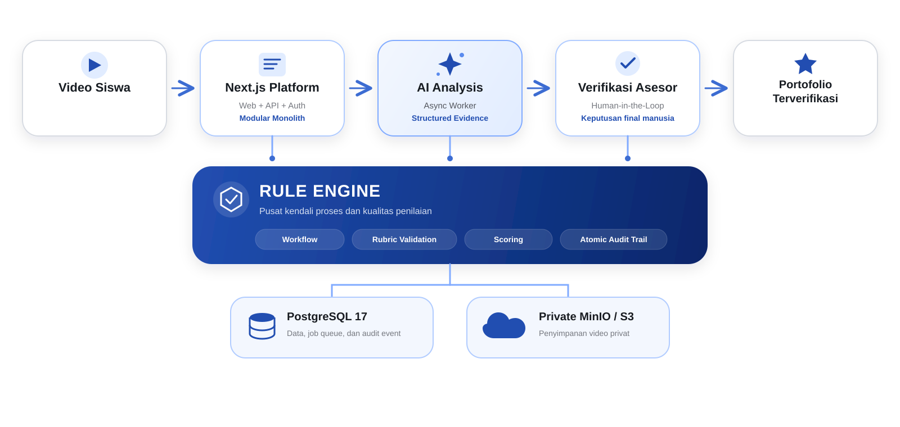

# Proofolio

**Platform bukti kompetensi siswa berbasis video, AI, dan verifikasi asesor.**

Proofolio membantu siswa mengubah video praktik menjadi portofolio kompetensi yang dapat dilacak
dan dibagikan. AI mempercepat pencarian bukti berdasarkan rubrik, sedangkan keputusan dan skor
akhir tetap berada di tangan asesor.

[Buka Live Demo](https://proofolio.jocimsus.tech) ·
[Login Asesor](https://proofolio.jocimsus.tech/assessor/login) ·
[OpenAPI](https://proofolio.jocimsus.tech/api/openapi.json)

## Demo Account

| Akses | Nilai |
|---|---|
| Website | [proofolio.jocimsus.tech](https://proofolio.jocimsus.tech) |
| Peran | Asesor |
| Email | `asesor@bukti.local` |
| Password | `DemoAsesor123!` |

> Akun ini bersifat publik. Jangan memasukkan data pribadi, rahasia, atau video sensitif. Untuk
> mencoba alur siswa, buat akun baru melalui halaman registrasi pada live demo.

## Mengapa Proofolio?

- **Evidence-based assessment** — penilaian terhubung langsung dengan bagian video yang relevan.
- **Human-in-the-loop** — AI hanya menyusun calon bukti; asesor tetap menetapkan keputusan akhir.
- **Rule Engine** — menjaga transisi workflow, validasi rubrik, perhitungan skor, dan audit trail.
- **Private by default** — video disimpan dalam object storage privat dan diakses melalui otorisasi.
- **Shareable portfolio** — siswa memilih hasil selesai untuk dibagikan melalui tautan yang dapat
  dicabut dan memiliki masa berlaku.

## Fitur Utama

### Untuk siswa

- Registrasi dan pengelolaan profil sekolah serta program keahlian.
- Login menggunakan email atau nomor telepon yang terdaftar.
- Melihat rubrik kompetensi aktif dan mengunggah video praktik.
- Memantau proses analisis dan review secara bertahap.
- Melihat skor serta feedback setelah penilaian difinalisasi.
- Menyimpan preferensi notifikasi status proses dan hasil penilaian secara terpisah.
- Menambahkan hasil terpilih ke portofolio dan membagikannya secara publik.

### Untuk asesor

- Login menggunakan email atau NIP/ID penguji setelah permohonan disetujui.
- Dashboard submission dalam organisasi yang sama.
- Membuat, mengekstrak calon rubrik dari PDF, dan mengelola beberapa versi rubrik.
- Memilih versi terbit yang aktif tanpa menonaktifkannya saat draft baru dibuat.
- Mengedit atau menghapus draft yang belum pernah diterbitkan.
- Memutar video privat serta melihat evidence dan timestamp hasil analisis AI.
- Mengonfirmasi, menolak, atau menyesuaikan evidence per kriteria.
- Menyimpan draft review dan memfinalisasi skor serta feedback.

## Rule Engine

Rule Engine menjadi lapisan kendali deterministik di antara hasil AI dan keputusan asesor:

- hanya mengizinkan transisi status submission yang legal;
- memvalidasi kriteria wajib, rentang skor, dan kelengkapan feedback;
- menghitung normalized score secara konsisten berdasarkan keseluruhan rubrik;
- membuat finalisasi atomic dan idempotent; dan
- mencatat perubahan penting sebagai audit event dalam transaksi yang sama.

```text
QUEUED -> ANALYZING -> AWAITING_REVIEW -> IN_REVIEW -> COMPLETED
                 \-> ANALYSIS_FAILED -> QUEUED (manual retry)
```

**AI menemukan bukti. Rule Engine menjamin aturan. Asesor menetapkan hasil.**

## Arsitektur



Proofolio menggunakan modular monolith: frontend dan HTTP API berada dalam satu aplikasi Next.js,
sedangkan analysis worker berjalan sebagai process terpisah dari image yang sama.

Alur utama:

1. Siswa mengunggah video; API menyimpan video secara privat dan membuat submission `QUEUED`.
2. Worker mengklaim job melalui PostgreSQL menggunakan row locking dan `SKIP LOCKED`.
3. Worker mengirim video dan snapshot rubrik ke Gemini untuk menghasilkan structured evidence.
4. Output AI divalidasi dan dinormalisasi sebelum disimpan per kriteria.
5. Asesor memverifikasi evidence, memberi skor, dan memfinalisasi hasil.
6. Siswa dapat memasukkan hasil `COMPLETED` ke portofolio dan membuat tautan publik.

## Tech Stack

| Area | Teknologi |
|---|---|
| Application | Next.js 16, React 19, TypeScript 5, Bun |
| UI | Tailwind CSS 4, shadcn, Base UI, TanStack Query |
| Authentication | Better Auth dengan cookie session |
| Database | PostgreSQL 17 dan Drizzle ORM |
| Object storage | MinIO / S3-compatible private storage |
| AI | Google Gemini multimodal dengan structured output |
| Background processing | PostgreSQL-backed job queue dan analysis worker |
| Validation & testing | Zod, Vitest, Playwright, ESLint |
| Deployment | Docker, Docker Compose, GHCR, GitHub Actions |

## Quick Start

### Prasyarat

- Docker Engine dan Docker Compose v2.
- Port `3000`, `5432`, `9000`, dan `9001` tersedia untuk development lokal.
- Gemini API key untuk analisis nyata; mode simulasi dapat berjalan tanpa provider eksternal.

### Menjalankan dengan Docker

```bash
git clone git@github.com:BuktiJoints/proofolio.git
cd proofolio
cp .env.example .env
```

Sebelum menjalankan stack:

1. Ganti `BETTER_AUTH_SECRET` dengan random secret minimal 32 karakter.
2. Untuk analisis nyata, isi `GEMINI_API_KEY` dan pertahankan `FAKE_AI=false`.
3. Untuk development tanpa Gemini, kosongkan key dan set `FAKE_AI=true`.

```bash
docker compose --env-file .env up -d --build
docker compose --env-file .env ps
curl -fsS http://localhost:3000/api/health/ready
```

Aplikasi tersedia di [http://localhost:3000](http://localhost:3000). MinIO Console tersedia di
`http://localhost:9001` dan hanya bind ke loopback pada Compose lokal.

Compose menjalankan migration dan seed sebelum web serta worker. Kredensial akun asesor lokal
mengikuti `SEED_ASSESSOR_EMAIL` dan `SEED_ASSESSOR_PASSWORD` di `.env`.

Untuk menghentikan stack tanpa menghapus data:

```bash
docker compose --env-file .env down
```

`docker compose down -v` menghapus volume PostgreSQL dan MinIO secara permanen. Gunakan hanya jika
data lokal memang tidak diperlukan.

## Konfigurasi

Gunakan [`.env.example`](./.env.example) sebagai referensi lengkap. Jangan commit `.env` atau
menampilkan nilainya pada log.

| Kelompok | Variable penting |
|---|---|
| App & auth | `NODE_ENV`, `BETTER_AUTH_URL`, `BETTER_AUTH_SECRET`, `DEFAULT_ORGANIZATION_SLUG` |
| Database | `POSTGRES_DB`, `POSTGRES_USER`, `POSTGRES_PASSWORD`, `DATABASE_URL` |
| Storage | `S3_ENDPOINT`, `S3_REGION`, `S3_ACCESS_KEY_ID`, `S3_SECRET_ACCESS_KEY`, `S3_BUCKET` |
| Gemini | `GEMINI_API_KEY`, `GEMINI_RUBRIC_MODEL`, `GEMINI_MODEL`, `FAKE_AI` |
| Worker | `WORKER_POLL_MS`, `WORKER_MAX_ATTEMPTS`, `WORKER_LEASE_MS`, `WORKER_HEARTBEAT_MS` |
| Upload | `UPLOAD_MAX_BYTES`, `UPLOAD_MAX_DURATION_SECONDS` |
| Sharing | `SHARE_TTL_HOURS` |
| Seed | `SEED_ASSESSOR_NAME`, `SEED_ASSESSOR_EMAIL`, `SEED_ASSESSOR_PASSWORD` |

Default upload aplikasi adalah **100 MiB** dengan durasi maksimal **120 detik**. Reverse proxy,
CDN, dan object storage dapat memiliki limit tambahan yang perlu diselaraskan saat deployment.

`GEMINI_RUBRIC_MODEL` digunakan khusus untuk ekstraksi PDF dan default ke `gemini-2.5-flash`,
sedangkan analisis video menggunakan `GEMINI_MODEL`. Ekstraksi PDF hanya melakukan satu percobaan
ke provider; kegagalan sementara ditampilkan secara aman agar pengguna dapat mencoba ulang secara
manual. Nama dan availability model dapat berubah, jadi set keduanya secara eksplisit di production
dan gunakan model yang telah diuji oleh tim.

## Development

Untuk menjalankan aplikasi di host, PostgreSQL dan MinIO tetap harus tersedia:

```bash
bun install
bun run db:migrate
bun run db:seed
bun run dev
```

Jalankan worker di terminal terpisah:

```bash
bun run worker
```

Perintah penting:

| Command | Fungsi |
|---|---|
| `bun run dev` | Menjalankan development server |
| `bun run build` | Membuat production build |
| `bun run worker` | Menjalankan analysis worker |
| `bun run db:migrate` | Menjalankan migration Drizzle |
| `bun run db:seed` | Membuat organisasi, asesor, bucket, dan rubrik demo |
| `bun run lint` | Menjalankan ESLint |
| `bun run typecheck` | Memeriksa TypeScript tanpa emit |
| `bun run test` | Menjalankan unit/domain tests |
| `bun run test:e2e` | Menjalankan API dan browser integration tests |

Verifikasi minimum sebelum commit:

```bash
bun run lint
bun run typecheck
bun run test
bun run build
docker compose --env-file .env config --quiet
```

Panduan pengembangan tambahan:

- [Frontend development](./docs/frontend-development.md)
- [Implementasi WBS](./docs/wbs-implementation.md)
- [Design system](./docs/design-system.md)

## Dokumentasi API

- [OpenAPI live](https://proofolio.jocimsus.tech/api/openapi.json)
- OpenAPI lokal: `GET /api/openapi.json`
- [API contract dan architectural decisions](./AGENTS.md)

API produk menggunakan prefix `/api/v1`, sedangkan lifecycle authentication ditangani melalui
`/api/auth`. Authentication menggunakan cookie session, bukan bearer token buatan aplikasi.

Perilaku API penting yang perlu diperhatikan:

- Login aplikasi menerima email atau nomor telepon siswa, serta email atau NIP asesor yang telah
  disetujui.
- Profil siswa menyimpan `notificationStatusEnabled` dan `notificationResultEnabled` sebagai
  preferensi yang terpisah.
- Membuat draft rubrik baru tidak menonaktifkan versi yang sedang aktif; versi terbit tetap
  immutable dan hanya versi aktif yang tersedia untuk upload siswa.
- `POST /api/v1/rubrics/:id/publish` menerima body opsional `{ "versionId": "uuid" }`; tanpa body,
  versi terbaru dipilih.
- Draft tertentu yang belum pernah diterbitkan dapat diubah atau dihapus melalui
  `/api/v1/rubrics/:id/versions/:versionId`.

## Deployment Production

`compose.prod.yml` menjalankan PostgreSQL 17, MinIO, migration, seed, web, dan worker. GitHub Actions
menerbitkan image `production` serta immutable SHA tag ketika branch `main` diperbarui.

### 1. Siapkan environment

Tambahkan konfigurasi berikut pada `.env` production:

```dotenv
APP_IMAGE=ghcr.io/buktijoints/proofolio
IMAGE_TAG=production
APP_BIND=127.0.0.1
APP_PORT=3000
BETTER_AUTH_URL=https://proofolio.example.com
GEMINI_RUBRIC_MODEL=gemini-2.5-flash
GEMINI_MODEL=gemini-3.7-flash
```

Isi seluruh secret dengan nilai production yang kuat dan unik, khususnya:

- `POSTGRES_PASSWORD`
- `BETTER_AUTH_SECRET`
- `S3_ACCESS_KEY_ID` dan `S3_SECRET_ACCESS_KEY`
- `GEMINI_API_KEY`
- `SEED_ASSESSOR_EMAIL` dan `SEED_ASSESSOR_PASSWORD`

`APP_BIND=127.0.0.1` cocok jika reverse proxy atau Cloudflare Tunnel berjalan pada host yang sama.
Gunakan binding lain hanya jika topologi jaringan memang membutuhkannya.

### 2. Pull dan jalankan

```bash
docker login ghcr.io
docker compose --env-file .env -f compose.prod.yml pull
docker compose --env-file .env -f compose.prod.yml up -d
docker compose --env-file .env -f compose.prod.yml ps
curl -fsS http://127.0.0.1:3000/api/health/ready
```

Startup production berlangsung berurutan: database sehat, migration selesai, seed selesai, lalu web
dan worker dijalankan.

### 3. Rollback

Gunakan immutable image tag dari GitHub Actions:

```dotenv
IMAGE_TAG=sha-<commit>
```

Kemudian jalankan kembali `pull` dan `up -d`. Backup PostgreSQL serta MinIO sebelum migration atau
deployment baru. Rollback image tidak otomatis mengembalikan schema database.

### Checklist production

- Gunakan HTTPS dan samakan `BETTER_AUTH_URL` dengan origin publik aplikasi.
- Jangan expose PostgreSQL atau MinIO API ke internet.
- Pertahankan MinIO Console pada loopback atau jaringan administratif privat.
- Gunakan credential berbeda dari contoh development dan akun demo publik.
- Batasi serta rotasi log; jangan mencatat password, API key, cookie, atau share token mentah.
- Pantau health check dan log `migrate`, `seed`, `web`, serta `worker`.
- Gunakan backup volume yang teruji dan immutable image tag untuk rollback.

## Security dan Privasi

- Video disimpan dalam private bucket dan hanya dialirkan setelah authorization atau validasi share.
- Public share menggunakan token acak; database hanya menyimpan hash token.
- Output AI diperlakukan sebagai untrusted input dan selalu memerlukan review asesor.
- Tenant boundary diterapkan berdasarkan ownership dan organisasi.
- Tautan publik dapat menampilkan video dan hasil akhir; bagikan hanya dengan persetujuan pemilik.
- Aplikasi belum menyediakan antivirus atau malware scanning khusus untuk upload.

Laporkan kerentanan secara privat kepada maintainer. Jangan menaruh detail exploit, credential,
atau data pengguna pada issue publik.

## Troubleshooting

### Readiness mengembalikan `503`

```bash
docker compose --env-file .env logs --tail=100 db minio migrate seed web
```

Readiness memeriksa PostgreSQL dan bucket object storage. Pastikan migration dan seed selesai serta
credential storage konsisten.

### Submission tetap `QUEUED` atau `ANALYZING`

```bash
docker compose --env-file .env logs --tail=200 worker
```

Pastikan worker aktif, Gemini key/model valid, quota tersedia, dan database serta storage sehat.

### Upload mendapat `413 Payload Too Large`

Periksa `UPLOAD_MAX_BYTES`, limit reverse proxy, dan limit request CDN. Menaikkan limit aplikasi
saja tidak cukup jika request masih dibatasi oleh proxy di depannya.

### Gemini gagal atau model tidak tersedia

Pastikan `GEMINI_MODEL` tersedia untuk API key yang digunakan. Kegagalan sementara akan mengikuti
bounded retry; kegagalan permanen mengubah submission menjadi `ANALYSIS_FAILED` agar dapat dicoba
ulang.

### Seed gagal terhubung ke MinIO

Pastikan service MinIO telah sehat dan aplikasi di dalam Compose menggunakan endpoint internal
`http://minio:9000`, bukan `localhost:9000`. Jalankan ulang service seed setelah MinIO siap.

## Known Limitations

- Preferensi notifikasi telah disimpan, tetapi pengiriman email/push belum tersedia.
- Foto profil masih berupa URL eksternal, bukan managed image upload.
- Dashboard menampilkan tahapan aktual tanpa ETA karena belum ada telemetry historis yang cukup.
- Upload belum memiliki antivirus atau malware scanning khusus.
- Coverage worker crash recovery, duplicate workers, startup ordering, dan target load masih perlu
  terus diperluas.

Detail kontrak dan gap implementasi terbaru tersedia di
[AGENTS.md](./AGENTS.md#9-known-implementation-gaps).

## License

Source code Proofolio dilisensikan menggunakan
[Apache License 2.0](./LICENSE). Dependency dan aset pihak ketiga tetap mengikuti lisensinya
masing-masing. Lisensi ini tidak memberikan hak untuk menggunakan nama atau identitas merek
Proofolio di luar penggunaan yang diperlukan untuk menjelaskan asal software.
